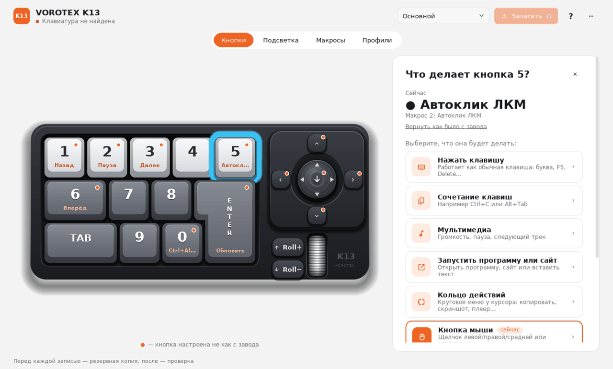
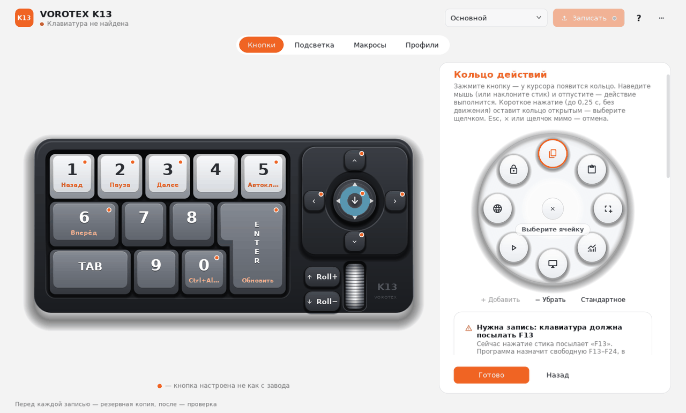
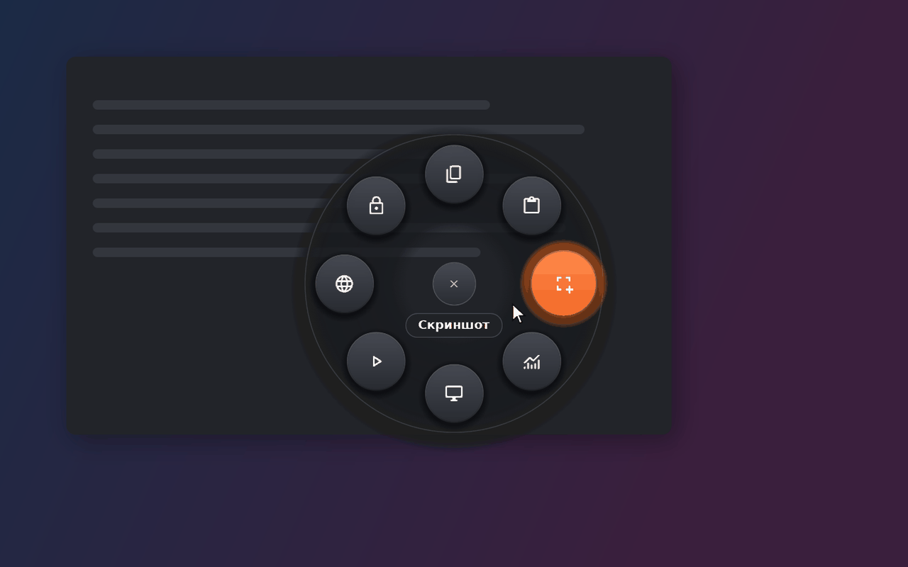
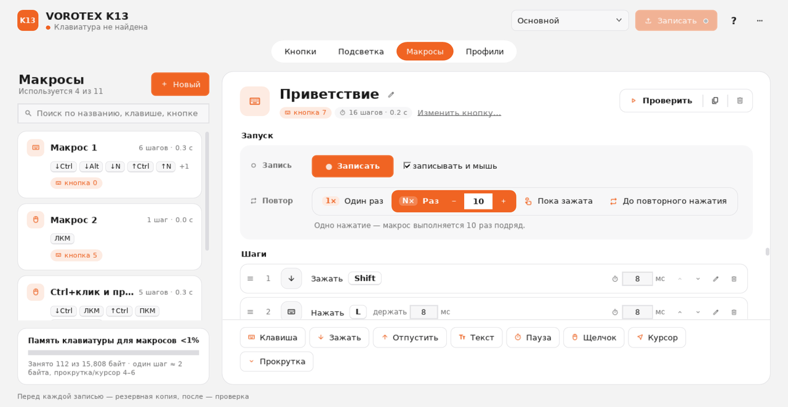
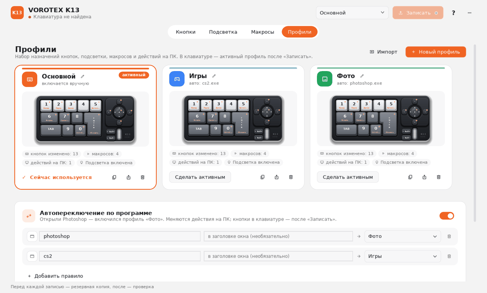
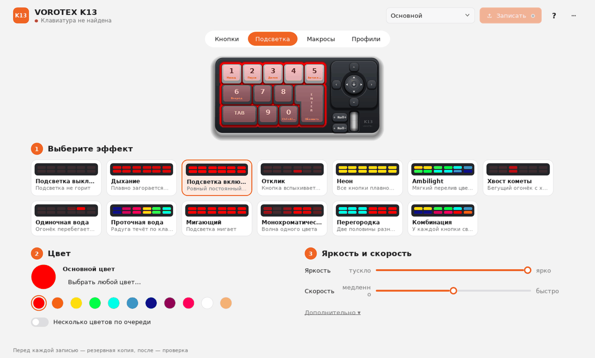
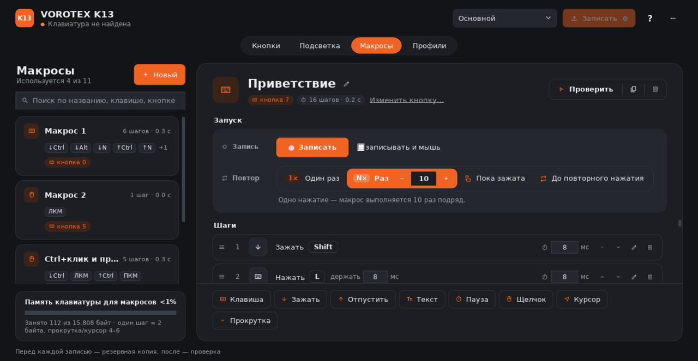

# VOROTEX K13 Studio

Своя программа для макропада **VOROTEX K13** (USB 30FA:2350) вместо родной: понятная настройка кнопок, стика, колеса, подсветки и макросов, кольцо действий у курсора и профили. Windows, WPF / .NET 8, один exe-файл без установки.

Текущая версия: **v4.9**

## Скриншоты

| | |
|---|---|
| <br>**Кнопки** — модель K13; точка показывает, что кнопка изменена | <br>**Назначение** — клавиша, сочетание, мультимедиа, программа, кольцо, мышь, макрос |
| <br>**Кольцо действий**: настройка слотов | <br>**Кольцо у курсора** — открывается стиком, выбор наклоном |
| <br>**Макросы** — карточки, «Запуск» (запись и повтор), шаги | <br>**Профили** — карточки с мини-K13 и автопереключение по программе |
| <br>**Подсветка** — 13 эффектов, цвет, яркость, скорость | <br>**Тёмная тема** |

<sub>Скриншоты отрисованы на Linux под Wine (`tools/render-wine`), поэтому шрифт и иконки здесь подменные. В Windows используются Segoe UI и Segoe Fluent Icons.</sub>

## Возможности

- **Кнопки, стик, колесо**: любая клавиша, сочетание, мультимедиа, F13–F24, кнопки мыши, макрос; скрытые кнопки 16/17.
- **Действия на ПК**: запуск программы или сайта, вставка текста, смена профиля, **кольцо действий** (стик: наклон — выбор, нажатие — запуск).
- **Макросы**: запись с клавиатуры и мыши, визуальный редактор (перетаскивание, правка на месте), режимы повтора: 1×, N× со степпером, «пока зажата» и «до повторного нажатия» (последние два работают в самой клавиатуре). Проверка на ПК играет ровно столько раз, сколько задано, и её можно остановить (Стоп/Esc).
- **Подсветка**: эффекты, цвета, яркость и скорость применяются сразу.
- **Профили**: имена, цвета и значки, экспорт/импорт .json, автопереключение по программе.
- **Безопасная запись**: подтверждение, резервная копия перед записью, проверка чтением после неё и автоматический откат при расхождении. Пишутся только изменённые блоки.
- Защита от случайной привязки клавиш основной клавиатуры (Shift, Ctrl, буквы…) как триггеров.

## Сборка

- `src/K13.Core` — протокол, кодек памяти, импорт config.ini, профили, резервные копии (кроссплатформенно, покрыто тестами).
- `src/K13.Studio` — окно WPF, трей, перехват клавиш (F13–F24 → действия на ПК), автопереключение профилей.
- `tests/K13.Core.Tests` — xUnit: round-trip дампов, воспроизведение Apply родной программы, безопасность записи, режимы макросов.

```
dotnet test tests/K13.Core.Tests -c Release
dotnet publish src/K13.Studio -c Release -o out/publish   # single-file, self-contained win-x64
```

Протокол и карта памяти: [docs/PROTOCOL.md](docs/PROTOCOL.md).
Данные: `%APPDATA%\VorotexK13Studio\profiles.json`, `%LOCALAPPDATA%\VorotexK13Studio\backups`, `studio.log`.
Только чтение: `VorotexK13Studio.exe --read-backup <папка>`. Скриншоты: `--render-screenshot`, `--render-v47`, `--render-v48`, `--render-v49 <папка>`.

## История изменений

### v4.9
- Исправлено: «Проверить» играл макрос не больше 5 раз (жёсткий предел в тестовом прогоне); теперь ровно столько, сколько задано, с кнопкой Стоп/Esc. Повтор с кольца/ПК тоже больше не урезается до 50 (повторное срабатывание останавливает).
- Число повторов сохраняется на каждое изменение (ввод, −/+, ↑/↓), ограничено 2…65535; в profiles.json и в клавиатуру уходит то же значение.
- Правильные окончания: «1 раз», «2 раза», «5 раз», «22 раза».
- Шапка макроса собрана: название, метки и «Изменить кнопку» слева, рядом — компактная группа «Проверить | копия | удалить»; карточка «Запуск» с рядами «Запись» и «Повтор» и пояснением; ширина контента ограничена (1040), на широком экране ничего не разъезжается.
### v4.8
- Повтор макроса: сегментный переключатель (1×, N× со степпером, «Пока зажата», «До повторного нажатия»), на узком окне раскладывается сеткой 2×2.
- «До повторного нажатия» — родной режим прошивки (mode2), работает без ПК.
### v4.7
- Новые разделы «Макросы» и «Профили» на карточках вместо таблиц; редактируемые имена макросов и профилей.
### v4.6
- Клавиши основной клавиатуры (Shift, Ctrl, буквы…) больше нельзя случайно назначить триггером; такие привязки удаляются при запуске.
### v4.5
- Клавиатура больше не «замолкает» при запуске программы: нет авточтения памяти, после каждого обмена отправляется выход из режима настройки.
### v4.4
- Быстрая запись (только изменённые блоки), подсветка применяется сразу, исправлены цвета.
