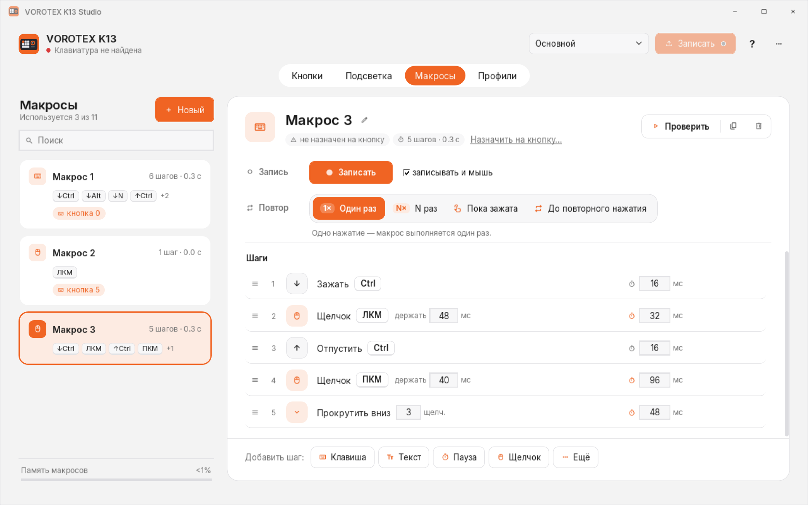
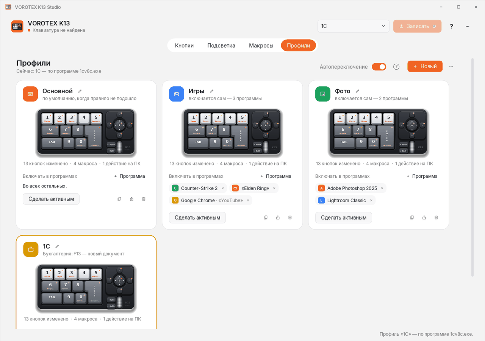
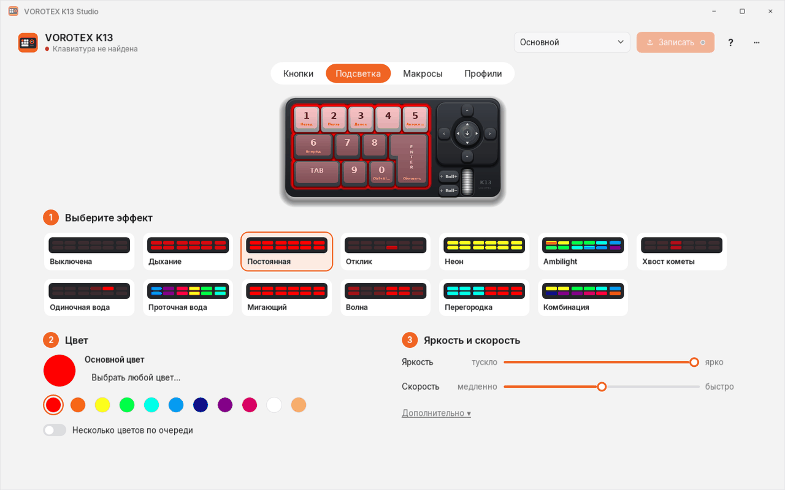
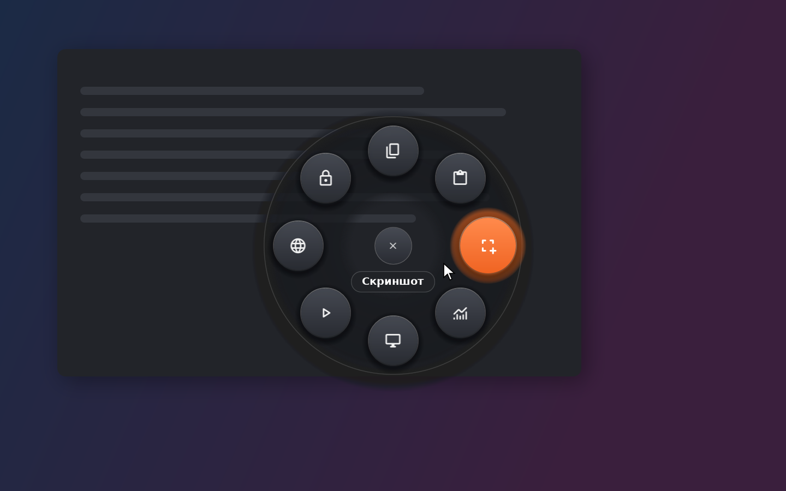

# VOROTEX K13 Studio

Своя программа для макропада **VOROTEX K13** (USB 30FA:2350) вместо родной: понятная настройка кнопок, стика, колеса, подсветки и макросов, кольцо действий у курсора и профили. Windows 10/11, WPF / .NET 8: установщик или один переносной exe-файл.

Текущая версия: **1.0.0 — стабильный выпуск** · **[⬇ Скачать](https://github.com/lle1ya/vorotex-k13-studio/releases/latest)**: `VorotexK13Studio-v1.0.0-setup.exe` (установщик, без прав администратора) или `VorotexK13Studio-v1.0.0.exe` (один файл, без установки). Программа раз в день проверяет, нет ли новой версии, и только сообщает (выключается в ⋯).

## Скриншоты

| | |
|---|---|
| <br>**Кнопки**: модель K13 и что делает выбранная кнопка | <br>**Макросы**: список слева, шаги справа |
| <br>**Профили**: карточки с мини-клавиатурой и программами, автопереключение в одну строку | <br>**Подсветка**: эффекты, цвет, яркость, скорость |
| <br>**Кольцо действий у курсора**: открывается стиком, выбор наклоном | |

<sub>Скриншоты отрисованы на Linux под Wine (`tools/render-wine`); значки Segoe Fluent Icons здесь подменные.</sub>

## Возможности

- **Кнопки, стик, колесо**: любая клавиша, сочетание, мультимедиа, F13, кнопки мыши, макрос; скрытые кнопки 16/17.
- **Действия на ПК**: запуск программы или сайта, вставка текста, смена профиля, **кольцо действий** (стик: наклон — выбор, нажатие — запуск). Кнопка посылает служебный сигнал (F13 или Scroll Lock + F), программа должна быть запущена.
- **Макросы**: запись с клавиатуры и мыши, визуальный редактор (перетаскивание, правка на месте), режимы повтора: 1×, N× со степпером, «пока зажата» и «до повторного нажатия». Настоящее «пока зажата» — через ПК, у одной выбранной кнопки (прошивка K13 сама не останавливает повтор при отпускании). Проверка на ПК играет ровно столько раз, сколько задано, и её можно остановить (Стоп/Esc).
- **Подсветка**: эффекты, цвета, яркость и скорость применяются сразу.
- **Кнопки по профилю (через ПК)**: после одной подготовительной записи каждая кнопка посылает свой короткий сигнал (Scroll Lock + F1…F11), а программа выполняет то, что назначено в **активном** профиле (клавиша, сочетание, макрос, медиа, запуск) — профили меняют кнопки мгновенно, без записи. Без программы можно работать в обычном режиме «Записать в клавиатуру».
- **Профили**: имена, цвета и значки; **автопереключение по программам** (Photoshop, игра, браузер с нужной вкладкой) с профилем по умолчанию, паузой из трея и **уведомлением на экране** при смене профиля; **экспорт/импорт `.k13profile`** (файл, перетаскивание в окно, буфер обмена) с просмотром перед импортом.
- **Резервные копии**: перед каждой записью; ⋯ → «Восстановить из резервной копии…» открывает копию профилем, в клавиатуру она попадает только после «Записать».
- **Безопасная запись**: проверка структуры памяти конкретной клавиатуры (разные ревизии, например метка `DA 1E` вместо `E1 1E`), подтверждение, резервная копия перед записью, проверка чтением после неё и автоматический откат при расхождении. Пишутся только изменённые блоки.
- Собственные заголовки окон и диалоги в стиле программы (светлая/тёмная тема, скруглённые углы в Windows 11), своя иконка, встроенный шрифт Inter.
- **Чёткость при любом масштабе Windows** (100/125/150/175 %): иконка в окне рисуется вектором по пиксельной сетке экрана, в .ico каждый размер (16–96 px) нарисован вручную по пикселям, в трей и на панель задач загружается ровно нужный размер; в интерфейсе нет растровых картинок и размытых сдвигов на полпикселя.
- Предупреждение, если выбранная клавиша (например F13) уже занята действием на ПК: видно, чем именно, и можно оставить или выбрать другую.
- Защита от случайной привязки клавиш основной клавиатуры (Shift, Ctrl, буквы…) как триггеров.

## Сборка

- `src/K13.Core` — протокол, кодек памяти, импорт config.ini, профили, резервные копии (кроссплатформенно, покрыто тестами).
- `src/K13.Studio` — окно WPF, трей, перехват клавиш (служебные сигналы → действия на ПК), автопереключение профилей.
- `installer/` — установщик Inno Setup 6 (собирается на Linux под Wine, см. `installer/README.md`).
- `tests/K13.Core.Tests` — xUnit: round-trip дампов, воспроизведение Apply родной программы, безопасность записи, режимы макросов.

```
dotnet test tests/K13.Core.Tests -c Release
dotnet publish src/K13.Studio -c Release -o out/publish   # single-file, self-contained win-x64
```

Протокол и карта памяти: [docs/PROTOCOL.md](docs/PROTOCOL.md).
Данные: `%APPDATA%\VorotexK13Studio\profiles.json`, `%LOCALAPPDATA%\VorotexK13Studio\backups`, `studio.log`.
Только чтение: `VorotexK13Studio.exe --read-backup <папка>`. Скриншоты: `--render-screenshot`, `--render-v47`, `--render-v48`, `--render-v49`, `--render-v50`, `--render-v52`, `--render-v572 <папка>` (v5.1 добавляет в папку `crisp-audit.txt` — проверку на эффекты, растровые картинки и дробные сдвиги).

## История изменений

### 1.0.0 — стабильный выпуск
- Первая стабильная версия. Основное проверено производителем VOROTEX на своей K13: действие на ПК без «через ПК», автоклик по удержанию через ПК, отключение USB во время удержания, выбор кнопки удержания, проверка обновлений, установщик и переносная версия.
- Проверка новой версии работает и при лимите GitHub API: версия берётся со страницы выпусков. Если GitHub не ответил — понятное сообщение, следующая попытка позже.
- Номер версии: после v5.10.1 идёт 1.0.0; старые версии видят 1.0.0 как более новую.
- Тесты: 386.

<details>
<summary>Более ранние версии (v5.10.1 и старше)</summary>

### v5.10.1 — без ложных предупреждений
- Производитель проверил v5.10.0 на своей K13: действие на ПК без «через ПК», удержание автоклика, отключение USB и «Отдать удержание этой кнопке» работают.
- Убраны ложные предупреждения: программа сверяет клавиатуру с тем, что на самом деле записывает «Записать» — сочетание Scroll Lock + F у действий на ПК и код «Меню» у кнопки удержания.
- Предупреждение «клавиатура прислала Num 2…» после переподключения объясняет режим Normal и само снимается, когда клавиатура перешла в Game, запись проверена или память после переподключения совпала.
- Тесты: 370 (+4, на дампах из диагностики производителя).

### v5.10.0 — действия на ПК через Scroll Lock + F, надёжность, установщик
- «Действие на ПК» без режима «через ПК» теперь записывается в клавиатуру как сочетание Scroll Lock + F (K13 не посылает F14–F24, поэтому раньше такие кнопки молчали). Старые профили менять не нужно — достаточно «Записать».
- Перехватчик: кнопки больше не «проскакивают» мимо программы при первом нажатии и не срабатывают дважды (хук + Raw Input); если Windows сняла перехватчик, он ставится заново.
- «Пока зажата» через ПК: код удержания по-прежнему один, но кнопку теперь выбираете вы — «Отдать удержание этой кнопке».
- Отключили клавиатуру посреди нажатия — удержания отпускаются, автоклик останавливается, обычные F-клавиши не перехватываются.
- ⋯ → «Восстановить из резервной копии…»: копия открывается профилем, в клавиатуру — только через «Записать».
- Понятные сообщения об ошибках на русском; испорченные данные клавиатуры не роняют программу.
- Честные подсказки: «пока зажата» в самой клавиатуре не останавливается при отпускании — так и написано.
- Установщик (для текущего пользователя, без прав администратора) и проверка новой версии раз в день — только уведомление, выключается в ⋯.
- Диагностические пункты меню — только с «Показать технические подробности».
- Тесты: 366 (+10).

### v5.9.8 — «Пока зажата» через ПК: настоящее удержание
- Оказалось, что K13 не останавливает повтор сигнала, когда кнопку отпускают, поэтому v5.9.6–v5.9.7 работали как «до повторного нажатия».
- Теперь после «Записать» кнопка с «Пока зажата» / «Автокликом» посылает отдельный код («Меню») с настоящим отпусканием: макрос крутится, пока кнопка зажата, и останавливается сразу после отпускания.
- По удержанию может работать одна такая кнопка (сначала с автокликом в активном профиле). Пока режим включён, клавиша «Меню» обычной клавиатуры тоже работает как эта кнопка.
- Тесты: 356.

### v5.9.7 — автоклик останавливается сразу после отпускания
- Остановка после отпускания быстрее: ≈ 0,1 с вместо 0,3 с (пауза подстраивается под клавиатуру).
- Страховка: если от K13 нет сигналов 0,6 с, «пока зажата» останавливается сама.
- Короткое нажатие больше не оставляет автоклик включённым.
- В журнале видно, каким путём шли сигналы и через сколько миллисекунд остановился макрос.
- Тесты: 358 (+3).

### v5.9.6 — «Пока зажата» и автоклик через ПК работают по удержанию
- В режиме «через ПК» кнопке с «Пока зажата» или «Автокликом» после «Записать» в клавиатуру записывается повтор её сигнала, пока она зажата. Программа держит действие, пока сигналы идут, и останавливает его через ≈ 0,3 с после отпускания (пауза подстраивается под клавиатуру).
- Если клавиатура всё же не повторяет сигнал, кнопка остаётся «старт / стоп», подсказка и журнал (`[hold]`) об этом говорят.
- Подтверждено производителем: после выключения «Запоминать режим» K13 снова стартует в Normal.
- Тесты: 355 (+6).

### v5.9.5 — кнопки «через ПК» работают, даже если Windows не передала их перехватчику
- Если Windows не передала нажатие кнопки K13 перехватчику программы, программа всё равно выполняет действие: сигнал берётся через Raw Input. Так было в журнале: v5.9.4 не получила ни одного нажатия Tab, поэтому автоклик не запускался.
- Если активное окно запущено от администратора, программа предупреждает и предлагает запустить Studio тоже от администратора: иначе Windows не даёт нажимать клавиши и мышь в таком окне. В журнал пишется, какое окно было активным.

### v5.9.4 — честные подсказки для «Пока зажата» и автоклика
- В режиме «Кнопки по профилю (через ПК)» макрос выполняет программа, а удержание кнопки ей не видно. Поэтому там «Пока зажата» и «Автоклик» теперь работают как «до повторного нажатия»: первое нажатие запускает, второе останавливает. Раньше повтор сразу обрывался.
- Подсказки говорят, где на самом деле выполняется кнопка: «Через ПК» или «В клавиатуре (проверяется)». Есть подсказка, как перенести её в клавиатуру: выключить «Кнопки по профилю» и нажать «Записать». Работа «пока зажата» в самой клавиатуре без программы ещё не подтверждена.
- Тесты: 349 (+4).

### v5.9.3 — «Запоминать режим» стал обычной настройкой
- Производитель VOROTEX проверил на своей K13: с включённым запоминанием клавиатура после переподключения USB сохраняет последний выбранный стиком режим — и Normal, и Game — даже при закрытой программе. Пометка «эксперимент» убрана.
- В окне объяснено, как это работает и что «Автоматически включать Game при подключении» при запущенной программе всё равно включает Game: чтобы сохранялся и Normal, эту галочку нужно снять. Об этом же напоминает сообщение после включения запоминания.
- Журнал при подключении сообщает, что клавиатура запомнила режим. Резервная копия перед записью, проверка и отдельное «Выключить запоминание…» остались как были.


### v5.9.2 — понятное окно «Запоминать режим»
- Окно крупно показывает «Сейчас: ВКЛЮЧЕНО» или «ВЫКЛЮЧЕНО». Когда запоминание включено, главная кнопка — «Готово». Выключение — отдельная кнопка со своим подтверждением, по умолчанию «Не выключать». Пункт меню тоже показывает «вкл/выкл».
- После включения программа подсказывает: закройте программу (и в трее) и переподключите USB, окно больше открывать не нужно.
- Если клавиатура сама стартовала в Game, это видно в заголовке и в журнале вместе с состоянием 0x000F.


### v5.9.1 — проверка после записи без ложных ошибок
- «Запоминать режим» записывался правильно (0x000F = 93), но проверка ошиблась. Первое чтение сразу после записи может вернуть записанный байт вместо соседнего (0x0008 прочитан как 93 вместо 80). Теперь программа ждёт, отбрасывает это чтение и сверяет два чтения подряд. Перед сообщением об ошибке делается ещё одно чтение.
- Сообщение об ошибке называет каждый отличающийся байт.
- Та же защита добавлена в проверку обычной записи настроек.
- Тесты: 345 (+7).

### v5.9 — «Запоминать режим» (эксперимент)
- ⋯ → **«Запоминать режим (эксперимент)…»**: заводской флаг клавиатуры (ячейка 0x000F, бит 1), с которым K13, вероятно, будет помнить режим Game после переподключения. Уверенность ≈ 60–65 %, на клавиатуре флаг ещё не проверялся. В окне описано, что делает функция и как её проверить. Запись выполняется только после подтверждения: сначала полная резервная копия, затем один байт и сверка. Выключить флаг или восстановить его из копии можно там же.
- Защита: байты 0x0000–0x0007 (тип памяти, VID/PID) программа не записывает никогда.
- В диагностике появились 0x000F и BASE+0. В репозитории — разбор заводской программы ([docs/ANALYSIS-burn-tool.md](docs/ANALYSIS-burn-tool.md)) и PROTOCOL §31.
- Тесты: 338 (+17), проверка интерфейса: 385 шагов без ошибок.


### v5.8.2 — понятнее меню режима Game
- Разовая команда теперь называется **«Включить Game сейчас»**, настройка — **«Автоматически включать Game при подключении»** (галочка). В меню ⋯ их разделяет черта, у обоих пунктов есть подсказки.
- Под новые названия обновлены подсказки, предупреждение о режиме Normal и описание стика.

### v5.8.1 — исправления по проверке v5.7.5
- **Ложное предупреждение «клавиатура всё ещё присылает F6 — заводская раскладка».** Программа сравнивала клавишу со старым сохранённым образом памяти, сделанным до того, как F6 назначили в программе производителя. Теперь клавиша сверяется только с памятью, прочитанной или записанной в текущем подключении. Если клавиша есть в ваших назначениях, она никогда не считается заводской. Подсказка про режим Normal появляется, только если пришла заводская клавиша, а статус показывает Normal или не определён.
- **Кольцо на стике получало F14 вместо F13.** Заранее подготовленная привязка «F13 → кольцо» считалась занятой, и кольцо уходило на свободную F14. Теперь кольцо всегда берёт F13. Если в профиле осталась F14, в редакторе стика об этом есть предупреждение, а кнопка «Кольцо действий» переводит стик на F13.
- Тесты: 321 (+6), проверка интерфейса: 383 шага без ошибок.

### v5.8 — режимы Normal и Game
По проверке производителя: у K13 два аппаратных режима. **Normal** — заводские клавиши, **Game** — ваши назначения (горит синий индикатор между Tab и 9). После подключения клавиатура всегда начинает в Normal, нажатие стика переключает режимы. Настройки не сбрасывались — прежние выводы «прошивка не загружает раскладку» исправлены.
- В заголовке виден текущий режим: «режим Game (ваши назначения)» или «режим Normal (заводские клавиши)». Он читается из статуса клавиатуры, без записи.
- **«Автоматически включать Game при подключении»** (⋯, по умолчанию включено) и пункт «Включить Game сейчас». Если клавиатура уже в Game, ничего не посылается.
- В режиме Normal появляется подсказка: нажмите стик или «Включить Game сейчас».
- Нажатие стика: выбор **«Переключение Normal/Game (заводское)»** или **«Кольцо действий»** с честным предупреждением — с кольцом на стике вернуться в Normal можно только переподключением. Кольцо можно повесить на другую кнопку. Новые профили сохраняют заводское переключение.
- Профили GAME и Normal в программе производителя пишут одну и ту же раскладку режима Game; заводской режим Normal не редактируется ни там, ни здесь.
- Тест «какая команда включает Game» после каждого шага читает режим и спрашивает про синий индикатор.
- Тесты: 315 (+6), проверка интерфейса: 383 шага без ошибок.

### v5.7.5 — наклоны стика всегда со стрелками
- **Наклоны стика не работали с записанной раскладкой.** В заводской памяти K13 у наклонов нет назначения (FF): по заводской раскладке стик посылает стрелки, а с записанной не посылает ничего. Программа сохраняла эти пустые ячейки. Теперь наклон без назначения записывается стрелкой (← → ↓ ↑). Если после чтения наклоны в клавиатуре пустые, программа предупредит, и одно «Записать» это исправит.
- В редакторе стика видно, что назначено на наклоны. Кнопки без назначения подписаны «ничего не посылает».
- Если кольцо открывалось, а от стика не пришло ни одного наклона, в журнале появляется подсказка.
- Активация раскладки при подключении и тест из v5.7.4 остались.
- Тесты: 309 (+6), проверка интерфейса: 381 шаг без ошибок.

### v5.7.4 — активация записанной раскладки при подключении
> Исправлено в v5.8: «заводская раскладка после переподключения» — это аппаратный режим Normal, а не сбой прошивки.
По проверке производителя: на их K13 записанная раскладка хранится в памяти (дамп после переподключения совпадает с записанным байт в байт), но после подачи питания работает заводская, пока программа не обратится к клавиатуре. Простое чтение памяти включает записанную.
- **«Активировать раскладку при подключении»** (⋯, по умолчанию включено). При подключении и при запуске программа отправляет короткий обмен из команд чтения: блок заголовка и завершение сеанса, ≈ 0,1 с, без записи. Чтобы это работало после перезагрузки компьютера, программа один раз предложит автозапуск в трей.
- В предупреждении «клавиатура прислала клавишу не из памяти» есть кнопка **«Активировать»**.
- **«Тест: какая команда включает раскладку…»** (⋯) по одной отправляет команды, из которых состоит чтение. После каждой вы нажимаете проверочную кнопку, программа сама видит, что пришло, и называет сработавшую команду.
- Без запущенной программы такая клавиатура после переподключения стартует с заводской раскладкой. Это поведение прошивки.
- Тесты: 303 (+5), проверка интерфейса: 379 шагов без ошибок.

### v5.7.3 — настройки после переподключения, наклоны кольца стрелками, диагностика
По отчёту производителя (K13 с заголовком памяти DA 1E).
- **Раскладка возвращалась к заводской после переподключения USB.** Программа сохраняла метку заголовка этой клавиатуры (DA 1E). Программа производителя при каждом «Применить» записывает в заголовок E1 1E, и, по-видимому, прошивка загружает настройки при включении только с этой меткой. Теперь заголовок записывается так же, как у производителя: `E1 1E <BASE> F0 0F 00 00`. Других команд не добавлено.
- **После записи** программа подсказывает, как проверить сохранение: выньте кабель и вставьте снова. После переподключения она предлагает сверить память (только чтение) и сообщает результат. Там же можно сохранить диагностику.
- **Наклоны кольца** работают и стрелками (заводская раскладка), и W/A/S/D. Клавиши берутся из того, что назначено на стик. Стрелки перехватываются только пока кольцо открыто.
- **«Прочитать → заменить»**: на экране показывается то, что реально лежит в памяти клавиатуры. Имена макросов, у которых изменилось содержимое, сбрасываются. Если клавиатура присылает клавишу, которой в её памяти нет (например, «Num 1» вместо «Пауза»), появляется предупреждение: она работает по заводской раскладке.
- **Диагностика** включает дамп памяти до записи, после записи и после переподключения (`k13-afterreplug-*.bin`), а также точную последовательность HID-кадров записи с временем и расшифровкой (`k13-hid-*.txt`).
- Тесты: 298 (+8), проверка интерфейса: 377 шагов без ошибок.

### v5.7.2 — карточки профилей возвращены, шапка и низ стали проще
- **Карточки профилей — как в v5.7:**
  - мини-клавиатура и строка о ней, «Включать в программах»;
  - «Сделать активным» или «✓ Сейчас используется»;
  - значки «дублировать / экспорт / удалить».
- **Шапка — одна строка:** «Профили» (под ним «Сейчас: Фото — по программе Photoshop.exe»), «Автопереключение» с «?», «+ Новый» и ⋯.
- **В ⋯ рядом с «Новый»:**
  - импорт из файла, вставка из буфера, экспорт всех;
  - профиль «В других программах», пауза;
  - «Уведомление при смене» (вкл/выкл, место, пример, уведомление Windows);
  - «Кнопки по профилю (через ПК)» — как и раньше, сначала подтверждение.
- **Внизу — одна строка вместо двух больших карточек:** «[переключатель] Действия на компьютере «Фото»: 1 действие · Настроить… ?».
- **Трей, автозапуск и тёмная тема** перенесены в главное меню ⋯ (справа вверху).
- Тесты: 290, проверка интерфейса: 375 шагов без ошибок.

### v5.7.1
- Экран «Профили» был переделан в виде «список + выбранный профиль». В v5.7.2 вернулись карточки.
- В README оставлены 5 основных скриншотов, старые версии свёрнуты.

### v5.7 — спокойнее и дружелюбнее
Тот же принцип, что у карточки автопереключения в v5.6, теперь на всех экранах. Функции не убраны, протокол и запись в клавиатуру не менялись.
- **Кнопки.** Список действий без рамки у каждой плитки: обведено только то, что выбрано сейчас. Подписи короче («Выберите действие»). Пояснение о режиме кнопки спрятано в «?» рядом с заголовком; предупреждения остаются на виду.
- **Кольцо действий и нажатие стика.** Одна короткая строка вместо абзаца, полная инструкция — в «?». Коды F13/0x68 и номера ячеек скрыты.
- **Кнопка мыши.** Строка о происхождении кода показывается только с техническими подробностями.
- **Макросы** (самый загруженный экран):
  - нет серой карточки «Запуск» внутри панели;
  - у шагов нет рамок, а «выше / ниже / изменить / удалить» появляются при наведении;
  - внизу «Добавить шаг: Клавиша · Текст · Пауза · Щелчок · Ещё». В «Ещё» — зажать и отпустить клавишу, сдвинуть курсор, прокрутка;
  - в списке слева не повторяется «не назначен на кнопку»;
  - память — тонкая полоска с процентом, байты только с подробностями.
- **Подсветка.** Карточки эффектов без рамок и без обрезанных описаний (они в подсказке), короткие названия («Постоянная», «Выключена», «Волна»). «медленно» больше не переносится.
- **Профили.**
  - На карточках нет цветной полосы, бейджа «активный» и серой подложки у мини-клавиатуры.
  - «Включать в программах» стал тихой подписью, иконки действий приглушены.
  - Внизу: «Действия на компьютере» без «триггеров/аккордов», карточка «Настройки».
- **Диалоги.**
  - «Проверка памяти»: адреса и байты только с подробностями.
  - «Включать в программе»: условие по заголовку окна свёрнуто в «Дополнительно».
  - «Импорт»: без номера формата.
- **Новое: «⋯ → Показать технические подробности».** Возвращает байты, коды, адреса и служебную строку внизу окна. По умолчанию выключено и запоминается.
- Профили и настройки прежних версий (режим «Кнопки по профилю», правила, принятый заголовок) загружаются без изменений. Это проверено тестом и на настоящих profiles.json.
- Тесты: 290 (+1), проверка интерфейса: 373 шага без ошибок (+6: подробности скрыты и показываются, «Ещё» в макросах, свёрнутое условие по заголовку). Скриншоты обновлены.

### v5.6.4
- **«Проходы чтения расходятся по адресу 0x0000 (BA ≠ FF)» на K13 производителя (заголовок DA 1E).** Причина: программа читала быстрее, чем официальная. После команды «загрузить блок» она сразу спрашивала байт, и на этой прошивке первый ответ прохода приходил из старого содержимого буфера (FF). Настоящее значение — BA. Ничего не записывалось: ошибка возникла до записи.
  - Чтение теперь как у официальной программы: паузы 1 мс на байт и 2 мс после загрузки, а в начале каждого чтения один «пустой» запрос, ответ на который выбрасывается.
  - Если проходы всё же расходятся, расходящиеся блоки перечитываются медленнее (до 3 раз) и каждый байт решается большинством голосов.
  - Если решить не удалось — понятное сообщение. Оба прохода сохраняются как `k13-readpass-A/B-*.bin` вместе с заметкой.
- **Папка резервных копий создаётся при запуске.** Сообщения больше не ссылаются на несуществующую папку. В окне ошибки есть кнопки «Открыть папку» и «Сохранить диагностику».
- **«⋯ → Сохранить диагностику…»** — один zip для проверки: studio.log, последние дампы (все k13-readpass), версия программы и Windows, сведения о клавиатуре.
- **F14–F24 убраны из выбора клавиш и макросов:** прошивка K13 их не посылает и вместо них нажимает заводскую клавишу (проверено 16.11). F13 работает.
  - Если действие на ПК назначено кнопке без режима «Кнопки по профилю», программа предупреждает, что оно сработает только в этом режиме.
- 8 новых тестов (модель «медленной» прошивки, голосование, файлы проходов, zip диагностики), всего 289; проверка интерфейса — 367 шагов без ошибок. Подробности — в PROTOCOL.md §26.

### v5.6.3
- **Найдена настоящая причина, почему «Кнопки по профилю» не работали.** В журнале 16.11 после подготовки клавиатура на нажатие Tab прислала обычный **Tab** (12:45:56 и ещё раз после переподключения в 12:46:13), хотя по проверке чтением в её ячейке был записан код F23. Значит, прошивка K13 **не умеет посылать F14–F24**: такие коды она молча заменяет заводской клавишей. Запись при этом работает — возврат макроса в 12:46:31 подействовал сразу, без переподключения. Официальная программа тоже предлагает только стандартные 104 клавиши.
- **Новая схема «через ПК»:** каждая кнопка запускает короткий макрос самой клавиатуры «Scroll Lock + F1…F11» — только стандартные коды, которые прошивка точно посылает (макросы уже проверены: «123» печатается). Программа ловит эту пару, глушит её и делает то, что назначено кнопке в активном профиле. Смена профиля — сразу, без записи.
- **Что сделать:** открыть v5.6.3, включить «Кнопки по профилю» и подтвердить «Подготовить и записать» (переподключать кабель не нужно). Если режим был подготовлен старой версией, программа покажет «Подготовьте её заново».
- Ограничения: кнопка срабатывает как нажатие (без удержания и автоповтора); все 11 макросов клавиатуры заняты режимом; пока режим включён, Scroll Lock обычной клавиатуры не действует; без запущенной программы кнопки нажимают Scroll Lock + F1…F11.
- 5 новых тестов по журналу (всего 281), проверка интерфейса — 363 шага без ошибок.

### v5.6.2
Диагностика и понятная запись в режиме «Кнопки по профилю».
- Журнал v5.6.1 показал: при включённом режиме «через ПК» программа **не получила от клавиатуры ни одного кода F14–F24** — перехват работал (видел другие клавиши), профили переключались, но переводить было нечего, поэтому макрос и не запускался. Теперь программа следит за кнопками самой K13 (Raw Input, только устройство VID_30FA&PID_2350 — основная клавиатура не читается) и пишет в журнал, что именно прислала клавиатура. Если вместо кода F14–F24 пришла обычная клавиша (например Tab) — на вкладке «Кнопки» и в строке состояния появляется предупреждение.
- В строке состояния видно, что сделала кнопка: «Кнопка Tab → макрос «…» (профиль «Основной», через ПК)».
- Рядом с «Записать»: «Запись не нужна — работает через ПК», когда изменения кнопок действуют сразу (раньше кнопка была просто серой), или «Нужно записать: подсветка…», когда запись действительно нужна.
- В журнал пишется, если пришёл код F14–F24, не назначенный ни одной кнопке.
- Добавлено 4 автотеста (всего 276), `--smoke-test` — 363 шага.

### v5.6.1
Срочное исправление v5.6.
- Исправлено: в Windows при наведении на «?» в карточке «Автопереключение по программам» появлялась ошибка «По умолчанию свойство ToolTip не поддерживает элемент ToolTip, для которого StaysOpen=false». Причина — подсказка «?» была сделана как ToolTip с `StaysOpen=false` (так WPF в Windows делать запрещает; под Wine это не проявлялось). Теперь при наведении — обычная подсказка, а по клику открывается отдельное всплывающее окно, которое закрывается кликом в любом другом месте.
- Исправлено: в режиме «Кнопки по профилю» кнопка могла повторять действие из предыдущего профиля (например, в Word «Основной» Tab нажимал обычный Tab, как в 1С, вместо макроса). Если Windows пропускала отпускание кнопки, программа считала её всё ещё зажатой и следующее нажатие принимала за автоповтор старого действия. Теперь нажатие, пришедшее позже 1,5 с после предыдущего, всегда считается новым и выполняется из активного профиля. Нажатие клавиш и запись в журнал вынесены из перехватчика в отдельный поток, чтобы Windows не пропускала события из-за медленного перехватчика.
- В журнал (`studio.log`) пишется, что сделала каждая кнопка: «кнопка 9 (VK 0x86) в профиле «Основной» → Macro…».
- Добавлены проверки: автотест ищет в исходниках ToolTip со `StaysOpen=false`, `--smoke-test` обходит все вкладки, проверяет каждую подсказку и открывает каждый «?» кликом; автотесты на потерянное отпускание и автоповтор. Всего 272 автотеста, 361 шаг проверки интерфейса.

### v5.6
Кнопки, зависящие от профиля, спокойная карточка «Автопереключение по программам» и исправление для переименованного файла программы.

**Кнопки по профилю (через ПК).** Раньше кнопки жили в самой клавиатуре: макрос на Tab из «Основного» срабатывал и в 1С, пока не нажать «Записать». Теперь можно включить режим, где кнопки зависят от активного профиля:
- Профили → «Кнопки по профилю» (или ссылка «Сделать через ПК…» на вкладке «Кнопки») → подтверждение → резервная копия, запись, проверка → выньте и вставьте USB-кабель. Это нужно один раз.
- После этого каждая кнопка посылает свой редкий код (F14–F24; F13 остаётся за стиком/кольцом), а программа выполняет назначение из **активного** профиля: клавишу, сочетание, мультимедиа, макрос, запуск программы/сайта, действие на ПК. Смена профиля (вручную или по программе) меняет кнопки сразу, без записи.
- Удержание и автоповтор как у обычной клавиши; макрос запускается один раз, «пока зажата» — останавливается при отпускании; если профиль сменился, пока кнопка зажата, отпускается именно то, что было нажато.
- Кодов F14–F24 одиннадцать, кнопок двенадцать: одна кнопка, одинаковая во всех профилях, остаётся в клавиатуре (это видно в диалоге и в описании кнопки). Джойстик, нажатие стика (кольцо) и подсветка остаются в клавиатуре; подсветка по-прежнему применяется через «Записать».
- Макросы кнопок «через ПК» играет программа из активного профиля; макросы, оставшиеся в клавиатуре, подписаны «записан в клавиатуру». Функции, которые умеет только клавиатура (подсветка, блокировка), на кнопке «через ПК» не работают — об этом предупреждение.
- Для каждой кнопки видно, что она делает сейчас и в каком режиме; если клавиатура записана иначе, чем показано, — предупреждение с тем, что в ней сейчас («Клавиатура делает не то, что показано…»).
- Режим требует запущенную программу (можно запускать вместе с Windows в трей). Выключить — переключатель «Кнопки по профилю»: в клавиатуру записываются кнопки активного профиля, и она снова работает без программы.

**Карточка автопереключения:**
- Заголовок — только название, «?» с пояснением (наведите или нажмите), «Пауза» и переключатель.
- Статус — одна строка: «Сейчас [1С] по программе 1cv8c.exe». Подробности (какая программа на переднем плане, её заголовок) — во всплывающей подсказке.
- Большой блок «что меняется сразу, а что — по «Записать»» убран: короткая подсказка показывается один раз (кнопка «Понятно»), дальше — в «?».
- Настройки — ровные строки «подпись — значение»: «В других программах» (профиль по умолчанию) и «Уведомление при смене» (переключатель + место). «Показать пример» и «уведомление Windows» — в меню ⋯. Длинные описания убраны.
- Карточки профилей: вместо четырёх «таблеток» — одна строка серым «13 кнопок изменено · 4 макроса · 1 действие на ПК» (подробности — в подсказке), короче подписи и подзаголовок вкладки.
- Исправлено: если файл программы переименован (например, `VorotexK13Studio-v5.5.exe`), её собственное окно считалось «другой программой» — в статусе было «VorotexK13Studio», а при переходе в окно программы мог включаться профиль по умолчанию. Теперь своё окно определяется по процессу, а в статусе остаётся последняя настоящая программа.
- Добавлено 36 автотестов (всего 267), `--smoke-test` — 359 шагов.

### v5.5
Уведомление при автоматической смене профиля.
- Когда профиль включается сам — вы перешли в программу из его списка (например, «1С» в 1cv8c) или вернулись в программу без правила и включился профиль по умолчанию — на экране появляется небольшое уведомление в стиле программы: значок и цвет профиля, «Профиль: 1С» и причина («по программе 1cv8c.exe»).
- Уведомление не забирает фокус у программы, в которой вы работаете (не появляется в Alt+Tab и на панели задач), показывается поверх окон, в том числе поверх полноэкранных программ в оконном режиме, плавно исчезает через 2 секунды; щелчок — скрыть сразу.
- Быстрая смена нескольких программ подряд не складывает уведомления стопкой: новое заменяет текущее.
- Показывается и при переключении профиля кнопкой на клавиатуре; при выборе профиля вручную в программе или в трее не показывается.
- В карточке «Автопереключение по программам»: переключатель «Показывать уведомление при смене профиля» (включён по умолчанию), место — внизу справа, вверху по центру или у курсора мыши, кнопка «Показать пример» и, по желанию, ещё и системное уведомление Windows (попадает в центр уведомлений).
- Добавлено 10 автотестов (всего 231) и 8 шагов в `--smoke-test` (всего 353).

### v5.4
Автопереключение профилей по программам и обмен профилями.
- **«Включать в программах»** на карточке каждого профиля: программу можно выбрать из запущенных (со значком и названием), указать файл .exe или просто ввести имя процесса. Дополнительно можно потребовать слово в заголовке окна — например, Chrome только на вкладке «YouTube», или игра, запущенная от администратора, по её заголовку.
- **Профиль по умолчанию** — включается в программах без правила (или «оставлять текущий профиль»).
- Видно, **какой профиль активен и почему**: «Активен: Фото — по программе Photoshop.exe», «выбран вручную», «переключён кнопкой клавиатуры», а также какая программа сейчас на переднем плане.
- Общий переключатель автопереключения, кнопка «Пауза» и пункт в меню трея «Приостановить автопереключение».
- Без мигания: окно должно продержаться на переднем плане 0,35 с (Alt+Tab через несколько окон ничего не переключает); окно самой программы, меню «Пуск», поиск и экран блокировки не учитываются. Ручной выбор профиля держится, пока вы не перейдёте в другую программу. Если Windows не даёт узнать имя программы (защищённые и некоторые запущенные от администратора процессы), профиль не меняется — такие программы можно ловить по заголовку окна.
- **Клавиатура при автопереключении не перезаписывается**: сразу меняются только действия на ПК (кольцо, сочетания, запуск программ и ссылок, макросы на компьютере — клавиши F13–F24). Кнопки и подсветка хранятся в самой клавиатуре и меняются только по «Записать» (после записи её нужно переподключить, а частая запись изнашивает память). Программа подсказывает, если раскладка в клавиатуре отличается от активного профиля.
- **Экспорт** одного или всех профилей в файл `.k13profile` (JSON с номером формата) вместе с их программами или **«Скопировать как текст»**. Пути к программам в папке пользователя заменяются на `%USERPROFILE%`, о других путях этого компьютера экспорт предупреждает.
- **Импорт** через кнопку «Импорт», **перетаскиванием файла в окно** или «Вставить» (Ctrl+V на вкладке «Профили»). Перед импортом показывается, что внутри: имя, сколько кнопок изменено, макросы, действия на ПК, программы, какие программы и ссылки профиль запускает. Если имя уже занято — «сохранить оба» (с номером) или «заменить».
- Строгая проверка файла: размер, глубина, число профилей, правил и шагов макросов, длина строк, коды клавиш, совместимость с памятью клавиатуры. Повреждённые, чужие или слишком большие файлы отклоняются с понятным сообщением, без падения программы. Открываются и старые файлы `.json` из прежних версий и полный `profiles.json`.
- Добавлено 42 автотеста (всего 221) и 20 шагов в `--smoke-test` (всего 345).

### v5.3
Проверка программы на ошибки и их исправление (без изменений в интерфейсе).
- Повреждённый `profiles.json` (например, после сбоя питания) больше не затирается пустыми профилями: файл откладывается как `profiles.json.corrupt-…`, профили берутся из предыдущего сохранения `profiles.json.bak`, программа показывает, что произошло. Сохранение стало атомарным: запись во временный файл, сброс на диск, затем замена с резервной копией `.bak`.
- Файлы профилей с пустыми/повторяющимися/слишком длинными именами, пропущенными полями или значениями вне диапазона (порог удержания, число ячеек кольца) исправляются при загрузке и импорте, а не роняют программу.
- Выход из программы во время чтения или записи клавиатуры больше не обрывает обмен на середине: программа дожидается окончания (сеанс закрывается как положено — 07 18 11 / 07 18 00 / 07 20) и только потом закрывается.
- Если запись оборвалась на середине (выдернули кабель, ошибка USB), программа пытается вернуть затронутые блоки из резервной копии и проверяет их; если клавиатура недоступна — сообщает путь к резервной копии.
- Завершение сеанса отправляет все три кадра, даже если первый не прошёл; резервные копии, сделанные в одну и ту же секунду, больше не перезаписывают друг друга.
- Макросы на ПК: «Стоп» срабатывает сразу, а не после текущей паузы; при выходе из программы проигрываемый макрос останавливается и отпускает все зажатые клавиши и кнопки мыши; режим «по кругу» на ПК крутится до повторного нажатия (раньше — один проход).
- Запись макроса: если «Стоп» нажат, пока клавиша ещё зажата, в конец добавляется её отпускание (раньше на клавиатуре клавиша оставалась зажатой). Автопереключение профиля во время записи больше не уносит шаги в чужой профиль.
- Действия на ПК: если Windows «потерял» отпускание клавиши (экран блокировки, окно UAC), эта клавиша больше не перестаёт работать до перезапуска.
- «Переключить профиль» на удалённый профиль больше не перескакивает на первый профиль. «Ввести текст»: перевод строки — настоящий Enter, табуляция — Tab.
- Поле «N раз» не падает при вводе нестандартных цифр (например, арабских). «1 блок / 2 блока / 5 блоков» вместо «блок(ов)». Текст приветствия больше не говорит, что запись выключена.
- Мелочи: утечки дескрипторов процессов и пунктов меню трея, защита от подмены системных DLL, повторный опрос клавиатуры не накладывается сам на себя. Добавлено 35 автотестов и режим `--smoke-test` для проверки всех вкладок и диалогов без клавиатуры.

### v5.2
- Исправлено: на некоторых K13 любая запись падала с ошибкой «Нет сигнатуры E1 1E по адресу 0xD0 (прочитано DA 1E)». Родная программа этот заголовок не проверяет, а просто записывает; первый байт метки у разных устройств/ревизий бывает разным (E1, DA…), второй (0x1E) — тот же. Теперь вместо точного сравнения проверяется структура памяти: BASE, хвост заголовка, указатели на раскладку и макросы, сама раскладка и таблица макросов. Если всё сходится — запись идёт как обычно, а метка устройства сохраняется.
- Если структура совпала не полностью — диалог в стиле программы показывает найденные байты и что именно не совпало и предлагает «Продолжить запись» или «Отмена». Резервная копия делается до вопроса, после записи — сверка и автоматический откат при расхождении. Ответ запоминается для этого заголовка.
- BASE больше не обязан быть 0xE0: адреса раскладки, подсветки и макросов считаются от BASE конкретной клавиатуры.
- Выбор обычной клавиши, код которой уже занят действием на ПК (например F13 — кольцо действий у стика): в списке и в поле выбора видно «занята: Кольцо действий», при сохранении — предупреждение с выбором «Оставить» / «Выбрать другую клавишу», а в карточке кнопки вместо просто «Кольцо» — «F13 · занята: Кольцо действий» с пояснением.

### v5.1
- Исправлены «пиксели»: иконка в заголовке окна, шапке и диалогах теперь не картинка из .ico, а векторный рисунок, который раскладывается по пикселям текущего масштаба (100/125/150/175 %) и привязан к целым пикселям экрана — без размытия и ступенек.
- .ico перерисован: каждый размер 16/20/24/30/32/36/40/48/64/72/96/256 px собран по пиксельной сетке без мыла (16–24 px — упрощённый рисунок 2×2 клавиши + стик); добавлены 30/36/72/96 px для 125/150/175 %.
- Панель задач и заголовок получают иконку точного размера для DPI окна (обновляется при переносе на другой монитор), трей — размер SM_CXSMICON для текущего DPI вместо сжатия большой картинки.
- Проверка чёткости всего интерфейса: убраны дробные сдвиги теней и текста (0.8/1.5/2.5/3.5 px → целые), подъём клавиш при наведении — на целые пиксели, лишние BitmapScalingMode удалены; эффектов (Blur/DropShadow) и растровых картинок в окнах нет. PerMonitorV2 в манифесте.

### v5.0
- Свой заголовок у всех окон: значок, название, кнопки «свернуть/развернуть/закрыть» (у диалогов только «закрыть»), светлая и тёмная тема. Сохранены перетаскивание, привязка к краям, двойной щелчок для разворота главного окна. В Windows 11 углы скруглены, тёмный режим DWM.
- Все системные MessageBox заменены диалогами в стиле программы (значок, текст, кнопки «Да/Нет/OK/Отмена»).
- Новая иконка (мини-K13 с оранжевым акцентом), .ico 16/20/24/32/40/48/64/256: панель задач, Alt+Tab, заголовки, трей.
- Встроенный шрифт Inter (OFL, 400/500/600/700) и единая шкала размеров 12/13/14/16/20/24, чёткий рендер текста (Display/ClearType).

### v4.9
- Исправлено: «Проверить» играл макрос не больше 5 раз (жёсткий предел в тестовом прогоне); теперь ровно столько, сколько задано, с кнопкой Стоп/Esc. Повтор с кольца/ПК тоже больше не урезается до 50 (повторное срабатывание останавливает).
- Число повторов сохраняется на каждое изменение (ввод, −/+, ↑/↓), ограничено 2…65535; в profiles.json и в клавиатуру уходит то же значение.
- Правильные окончания: «1 раз», «2 раза», «5 раз», «22 раза».
- Шапка макроса собрана: название, метки и «Изменить кнопку» слева, рядом — компактная группа «Проверить | копия | удалить»; карточка «Запуск» с рядами «Запись» и «Повтор» и пояснением; ширина контента ограничена (1040), на широком экране ничего не разъезжается.
### v4.8
- Повтор макроса: сегментный переключатель (1×, N× со степпером, «Пока зажата», «До повторного нажатия»), на узком окне раскладывается сеткой 2×2.
- «До повторного нажатия» — родной режим прошивки (mode2), работает без ПК.
### v4.7
- Новые разделы «Макросы» и «Профили» на карточках вместо таблиц; редактируемые имена макросов и профилей.
### v4.6
- Клавиши основной клавиатуры (Shift, Ctrl, буквы…) больше нельзя случайно назначить триггером; такие привязки удаляются при запуске.
### v4.5
- Клавиатура больше не «замолкает» при запуске программы: нет авточтения памяти, после каждого обмена отправляется выход из режима настройки.
### v4.4
- Быстрая запись (только изменённые блоки), подсветка применяется сразу, исправлены цвета.

</details>
